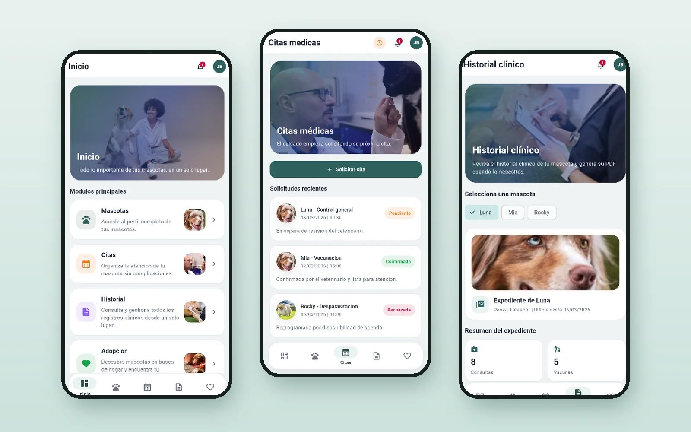
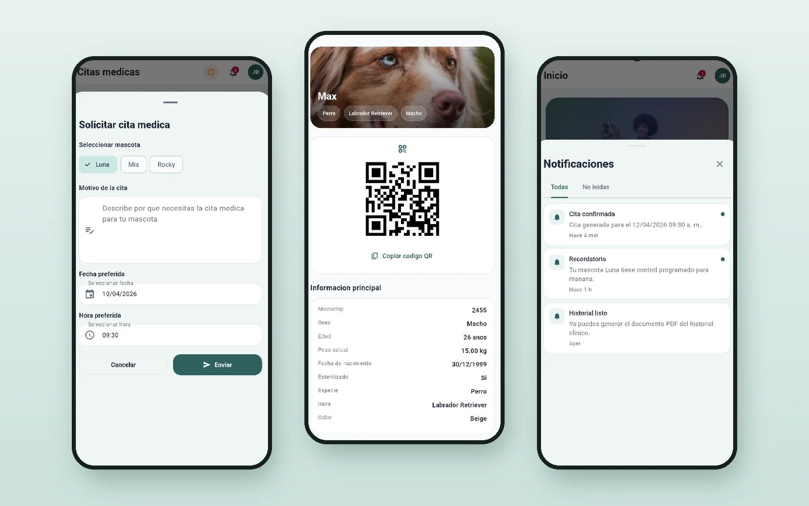

# PetSafe · App móvil

App móvil para los dueños de mascotas de la clínica veterinaria **PetSafe**: permite revisar el perfil y el historial clínico de cada mascota, solicitar citas, recibir notificaciones al instante y explorar mascotas en adopción.

Forma parte del ecosistema PetSafe, junto con el [backend](https://github.com/STRATIUM-UTA/PetSafe-Back) y el [panel web](https://github.com/STRATIUM-UTA/PetSafe-Front) que usa el personal de la clínica.

<p align="center">
  
</p>

## Funcionalidades

- **Inicio de sesión seguro** con recuperación de contraseña; la sesión se guarda cifrada en el dispositivo.
- **Mascotas:** lista, perfil detallado y código QR de cada mascota.
- **Citas médicas:** solicitud de citas y seguimiento de su estado (pendiente, confirmada, reprogramada).
- **Historial clínico:** consultas y vacunas de cada mascota, con descarga del expediente en PDF.
- **Notificaciones push** con Firebase Cloud Messaging (citas confirmadas, recordatorios, historial listo) y bandeja de notificaciones leídas y no leídas.
- **Adopción:** catálogo de mascotas en busca de hogar y detalle de cada una.
- **Perfil** del dueño y aviso cuando el dispositivo pierde la conexión.

<p align="center">
  
</p>

## Tecnologías

| Área | Herramientas |
| --- | --- |
| App | Flutter, Dart |
| Red | Dio, connectivity_plus |
| Notificaciones | Firebase Core, Firebase Cloud Messaging |
| Almacenamiento | flutter_secure_storage, Hive, shared_preferences |
| Utilidades | qr_flutter, path_provider, open_file, flutter_dotenv |
| Pruebas E2E | Maestro |

## Estructura del proyecto

```
lib/
├── app/            # Enrutamiento y tema
├── core/           # Arranque, configuración, red, notificaciones, seguridad, almacenamiento y widgets comunes
└── features/       # Una carpeta por funcionalidad, cada una con data/ y presentation/
    ├── auth/  dashboard/  pets/  appointments/  history/
    └── notifications/  reminders/  adoption/  profile/  shell/
Maestro_Testing/    # Flujos de prueba de extremo a extremo
```

## Cómo ejecutarla

**Requisitos:** Flutter SDK (Dart 3.11 o superior), un emulador o dispositivo Android, y el [backend de PetSafe](https://github.com/STRATIUM-UTA/PetSafe-Back) en ejecución.

```bash
git clone https://github.com/JoelBonillaG/petsafe_movil_app.git
cd petsafe_movil_app
cp .env.example .env      # define API_BASE_URL (en el emulador de Android: http://10.0.2.2:3000/api)
flutter pub get
flutter run
```

## Pruebas de extremo a extremo

La carpeta `Maestro_Testing/` contiene 9 flujos automatizados con [Maestro](https://maestro.mobile.dev/):

| # | Flujo | # | Flujo |
| --- | --- | --- | --- |
| 01 | Inicio de sesión | 06 | Historial clínico |
| 02 | Recuperación de contraseña | 07 | Adopción |
| 03 | Mascotas | 08 | Perfil |
| 04 | Solicitud de cita | 09 | Cierre de sesión |
| 05 | Notificaciones | | |

```bash
maestro test Maestro_Testing/
```

## Equipo y créditos

PetSafe se desarrolló en equipo en la carrera de Ingeniería en Software de la Universidad Técnica de Ambato.

- **[Joel Bonilla](https://github.com/JoelBonillaG):** app móvil (este repositorio), módulo de notificaciones y pruebas con Maestro.
- **[David Barragán](https://github.com/DavidJosueP2)**, **[David Manjarres](https://github.com/DRTX2)** y **[Josué García](https://github.com/JosueGarciaAbata)**: backend y panel web, junto con Joel.

**Repositorios relacionados:** [PetSafe-Back](https://github.com/STRATIUM-UTA/PetSafe-Back) · [PetSafe-Front](https://github.com/STRATIUM-UTA/PetSafe-Front) · [Demo web](https://pet-safe-six.vercel.app/login)
