# PetSafe · App móvil


App móvil para los dueños de mascotas de la clínica veterinaria **PetSafe**. Desde el celular, el dueño revisa el perfil y el historial clínico de cada mascota, solicita citas, recibe un aviso al instante cuando la clínica responde y explora mascotas en adopción.

Forma parte del ecosistema PetSafe, junto con el [backend](https://github.com/STRATIUM-UTA/PetSafe-Back) y el [panel web](https://github.com/STRATIUM-UTA/PetSafe-Front) que usa el personal de la clínica.

<p align="center">
  
</p>

## Contenido

- [Funcionalidades](#funcionalidades)
- [Galería de pantallas](#galería-de-pantallas)
- [Arquitectura](#arquitectura)
- [Tecnologías](#tecnologías)
- [Cómo ejecutarla](#cómo-ejecutarla)
- [Pruebas de extremo a extremo](#pruebas-de-extremo-a-extremo)
- [Equipo y créditos](#equipo-y-créditos)

## Funcionalidades

### 🔐 Inicio de sesión seguro
El dueño entra con su correo y contraseña. La sesión se guarda **cifrada** en el dispositivo y se **renueva sola** con un token de actualización, así que no tiene que volver a iniciar sesión cada vez que abre la app. Si olvida su contraseña, puede **recuperarla** con un PIN que recibe en su correo.

### 🏠 Inicio
Una pantalla de bienvenida con acceso directo a los módulos principales (mascotas, citas, historial y adopción) y un indicador de notificaciones pendientes en la parte superior.

### 🐾 Mascotas
Lista de las mascotas del dueño con **buscador** y una ficha detallada de cada una: especie, raza, sexo, peso, edad y microchip. Cada mascota tiene su propio **código QR** para identificarla en la clínica. Las mascotas quedan guardadas en el dispositivo, por lo que **se pueden consultar sin conexión**, y la app avisa cuando muestra datos guardados.

### 📅 Citas médicas
El dueño **solicita una cita** eligiendo la mascota, el motivo y la fecha y hora que prefiere. Luego sigue el **estado de cada solicitud** (pendiente, confirmada o rechazada) junto con la respuesta de la clínica, por ejemplo cuando una cita se reprograma por disponibilidad de agenda.

### 📋 Historial clínico
Para cada mascota muestra un resumen del expediente (número de consultas y vacunas), el detalle de las **consultas médicas** y el **registro de vacunas**. El expediente completo se puede **descargar en PDF** y abrir directamente en el celular.

### 🔔 Notificaciones
Avisos **push en tiempo real** con Firebase Cloud Messaging: cita confirmada, recordatorio de control, historial listo para descargar, entre otros. Llegan tanto con la app abierta como en segundo plano, y al tocarlos abren la app. Dentro de la app hay una **bandeja** con pestañas *Todas* y *No leídas*, un **contador** de pendientes y la opción de **marcar todas como leídas**.

### ❤️ Adopción
Catálogo de mascotas que buscan un hogar, con la ficha de cada una para que el dueño conozca su historia antes de decidirse.

### 👤 Perfil
Datos del dueño, configuración del perfil y cierre de sesión. Además, la app **detecta cuando el celular pierde la conexión** y lo indica al usuario.

## Galería de pantallas

<table>
  <tr>
    <td align="center">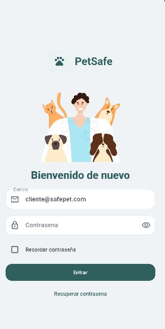<br/><sub>Inicio de sesión</sub></td>
    <td align="center">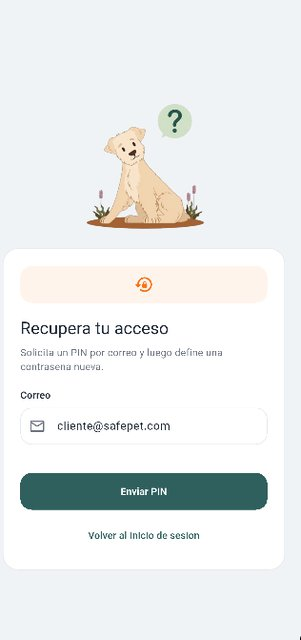<br/><sub>Recuperar contraseña</sub></td>
    <td align="center">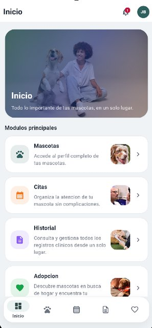<br/><sub>Inicio</sub></td>
    <td align="center">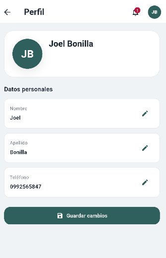<br/><sub>Perfil</sub></td>
  </tr>
  <tr>
    <td align="center">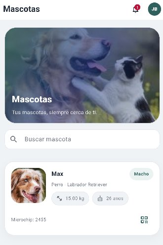<br/><sub>Mis mascotas</sub></td>
    <td align="center">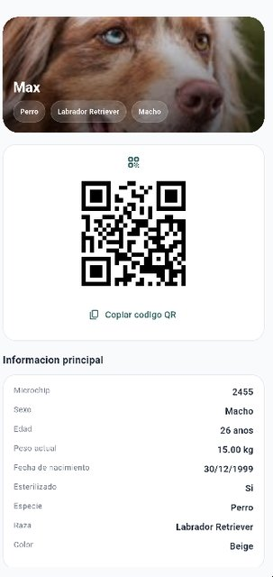<br/><sub>Ficha de la mascota</sub></td>
    <td align="center">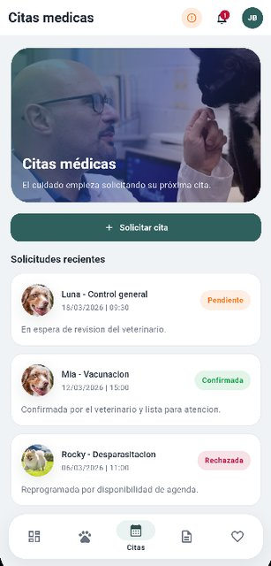<br/><sub>Citas médicas</sub></td>
    <td align="center">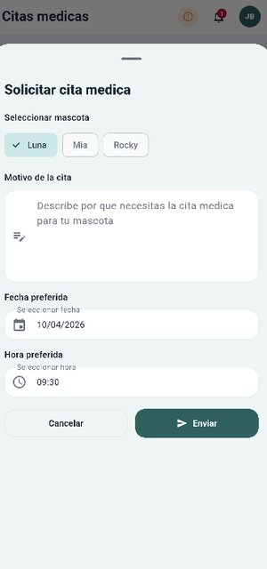<br/><sub>Solicitar cita</sub></td>
  </tr>
  <tr>
    <td align="center">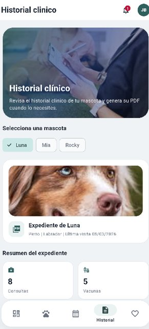<br/><sub>Historial clínico</sub></td>
    <td align="center">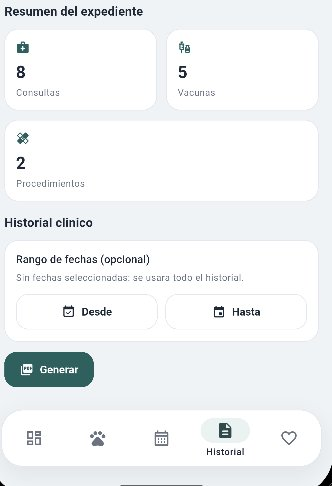<br/><sub>Consultas y vacunas</sub></td>
    <td align="center">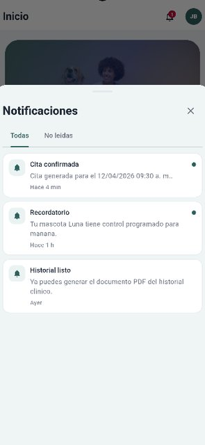<br/><sub>Notificaciones</sub></td>
    <td align="center">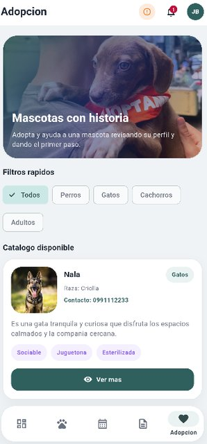<br/><sub>Adopción</sub></td>
  </tr>
</table>

## Arquitectura

El código está organizado **por funcionalidad**. Cada módulo separa los datos (servicio de API, modelos y repositorio) de la presentación, y comparte servicios comunes desde `core/`.

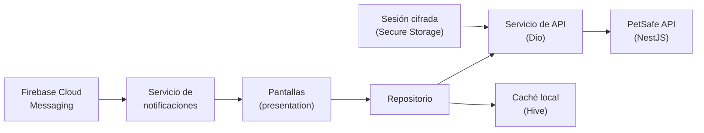

```
lib/
├── app/            # Enrutamiento y tema visual
├── core/
│   ├── bootstrap/      # Arranque de la app (Hive, Firebase, configuración)
│   ├── network/        # Cliente HTTP y estado de la conexión
│   ├── notifications/  # Servicio de notificaciones push (FCM)
│   ├── security/       # Utilidades para los tokens JWT
│   ├── storage/        # Sesión cifrada, preferencias y caché local
│   └── widgets/        # Componentes reutilizables
└── features/       # Un módulo por funcionalidad: data/ + presentation/
    ├── auth/  dashboard/  pets/  appointments/  history/  vaccinations/
    └── notifications/  reminders/  adoption/  profile/  shell/
Maestro_Testing/    # Flujos de prueba de extremo a extremo
```

## Tecnologías

| Área | Herramientas |
| --- | --- |
| App | Flutter, Dart |
| Red | Dio, connectivity_plus |
| Notificaciones | Firebase Core, Firebase Cloud Messaging |
| Almacenamiento | flutter_secure_storage (sesión), Hive (caché), shared_preferences |
| Utilidades | qr_flutter, path_provider, open_file, flutter_dotenv |
| Pruebas E2E | Maestro |

## Cómo ejecutarla

**Requisitos:** Flutter SDK (Dart 3.11 o superior), un emulador o dispositivo Android, y el [backend de PetSafe](https://github.com/STRATIUM-UTA/PetSafe-Back) en ejecución.

```bash
git clone https://github.com/JoelBonillaG/petsafe_movil_app.git
cd petsafe_movil_app
cp .env.example .env      # define API_BASE_URL (en el emulador de Android: http://10.0.2.2:3000/api)
flutter pub get
flutter run
```

## Pruebas de extremo a extremo

La carpeta `Maestro_Testing/` contiene **9 flujos automatizados** con [Maestro](https://maestro.mobile.dev/) que recorren la app como lo haría un usuario real:

| # | Flujo | Qué comprueba |
| --- | --- | --- |
| 01 | Inicio de sesión | Acceso con credenciales válidas |
| 02 | Recuperación de contraseña | Pantalla de recuperación con PIN por correo |
| 03 | Mascotas | Ficha de una mascota con sus datos y microchip |
| 04 | Solicitud de cita | Envío de una nueva solicitud |
| 05 | Notificaciones | Apertura de la bandeja de notificaciones |
| 06 | Historial | Consultas, vacunas y descarga del PDF |
| 07 | Adopción | Catálogo y detalle |
| 08 | Perfil | Configuración de los datos personales |
| 09 | Cierre de sesión | Salida segura de la cuenta |

```bash
maestro test Maestro_Testing/
```

## Equipo y créditos

PetSafe se desarrolló en equipo en la carrera de Ingeniería en Software de la Universidad Técnica de Ambato.

| Integrante | Aporte |
| --- | --- |
| [Joel Bonilla](https://github.com/JoelBonillaG) | App móvil (este repositorio), módulo de notificaciones y pruebas con Maestro |
| [David Barragán](https://github.com/DavidJosueP2) | Backend y panel web |
| [David Manjarres](https://github.com/DRTX2) | Backend y panel web |
| [Josué García](https://github.com/JosueGarciaAbata) | Backend y panel web |

**Repositorios relacionados:** [PetSafe-Back](https://github.com/STRATIUM-UTA/PetSafe-Back) · [PetSafe-Front](https://github.com/STRATIUM-UTA/PetSafe-Front) · [Demo web](https://pet-safe-six.vercel.app/login)
